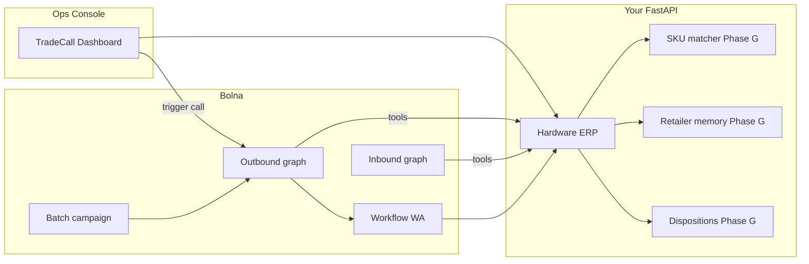

# TradeCall — Final Plan (Bolna Buildathon → Symphony)

## Product name and thesis

**TradeCall** (working brand; rename later if needed) — VoiceOps for **hardware distributors**.

- **Outbound:** Agent calls hardware retailers in Hindi/Hinglish, recalls history, takes this week’s order, checks warehouse stock, confirms, creates order, sends WhatsApp.
- **Inbound:** Retailer calls back — identify by **phone** and/or **order ID** — speak **status + delivery ETA**.
- **Ops console:** Distributor sees retailers, triggers route calls, watches orders, advances status, sees WA outbox.

**Who pays:** Regional hardware wholesalers (not the kirana shop).  
**Why voice:** Shop owners won’t type SKUs into an app during business hours; phone is already the workflow.  
**Wedge (after demo):** Fuzzy hardware SKU understanding + retailer memory across calls.

---

## Build order (locked)

**Rule:** Do **not** start Phase G until Phases A–F produce a flawless dual-phone demo you can show in an interview.

| Phase | Goal | Done when |
|-------|------|-----------|
| **A** | Backend truth | curl creates order, looks up by phone, returns status/ETA |
| **B** | Outbound real call | Your phone gets order-taking call; order lands in DB |
| **C** | Inbound + dual loop | Same phone calls in; hears status/ETA for that order |
| **D** | Product UI | Console replaces Postman for the live demo |
| **E** | Edge stories | 3+ failure paths demoable live |
| **F** | Company pitch | Apply + submit video/one-pager by **Oct 31** |
| **G** | Win layer | Differentiators *after* demo is solid |

---

## Domain

| Concept | Hardware example |
|---------|------------------|
| Retailer | Sharma Electricals, Gupta Sanitary, Metro Hardware |
| Distributor | Bharat Hardware Distributors |
| SKUs | Copper wire 1.5mm, PVC pipe 1", MCB 32A, wall putty 40kg, GI elbow ¾" |
| Units | piece, box, coil, meter, bag, packet |
| Statuses | `confirmed` → `packed` → `dispatched` → `out_for_delivery` → `delivered` (+ `partial`, `cancelled`) |

Seed: ~8–12 retailers (one = your phone), ~25 SKUs with Hindi/Hinglish aliases.

---

## Architecture

**Memory split (learn this):**
- Call context → Bolna `user_data` / extracted slots (this call only)
- Business truth → your DB (orders, stock, phones, ETA)
- Phase G memory → last 3 orders, usual brands, credit terms in DB, loaded into `user_data` at call start

**Repo:**
- `backend/` — FastAPI ERP
- `bolna/` — graph JSON, tools, workflow, batch CSV
- `dashboard/` — TradeCall ops console
- `demo/` — scripts, edge checklist, pitch one-pager
- `scripts/` — seed, tunnel, smoke tests

**Stack (near-free):** Bolna graph + workflow · `gpt-4.1-mini` · Sarvam STT/TTS (hi) · Deepgram (en/Flux) · Plivo/Exotel · mock WA first · public tunnel/Render.

---

# PHASES A–F — Must-have demo (build first)

## Phase A — Backend (no Bolna yet)

Learn by curl before any voice spend.

**Endpoints:**
- `GET /health`
- `GET /v1/retailers`, `GET /v1/retailers/{id}`
- `GET /v1/retailers/by-phone/{phone}`
- `GET /v1/retailers/{id}/last-order`
- `POST /v1/stock/check`
- `POST /v1/orders` → returns `order_id`, provisional `eta_text`
- `GET /v1/orders/{id}`, `GET /v1/orders/{id}/status`
- `PATCH /v1/orders/{id}/status` — demo scrubber
- `POST /v1/whatsapp/send`, `GET /v1/whatsapp/outbox`
- `POST /v1/demo/trigger-call` (later, wraps Bolna)

Auth: `Bearer DEMO_TOKEN`.

**Teaching checkpoint:** You can explain request → handler → DB → JSON for every route.

---

## Phase B — Outbound graph + real phone

Bolna skills/MCP: `setup-api-key`, `bolna-graph-agents`, `setup-tools`, `make-call`.

**Outbound nodes:** `welcome_recall` → `collect_requirements` → `check_stock` → `adjust_unavailable` → `confirm_order` → `create_order` → `closing_whatsapp` → `end_call` (+ `offer_callback`).

**Tools:** `get_last_order`, `check_stock`, `create_order` (node-scoped).

**Done when:** Real outbound call to your number creates an order visible via API.

---

## Phase C — Inbound status + dual demo

**Inbound nodes:** `inbound_welcome` → `identify_retailer` → `collect_order_id` (if needed) → `speak_status_eta` → `inbound_followup` → end or jump to collect.

**Tools:** `lookup_retailer_by_phone`, `get_order_status`.

**Flawless dual demo script:**
1. Console/API triggers outbound → place order → note `ORD-xxxx`
2. Scrub status to `dispatched` + ETA
3. Dial inbound from same phone → agent speaks status + ETA
4. WhatsApp outbox shows confirmation from step 1

---

## Phase D — Ops console (product, not Postman)

Single-screen TradeCall UI:
- Retailer list (shop, phone, last order)
- **Call** / **Call route** button
- Live/recent order card (line items, id, status)
- **Status scrubber** (advance packed → dispatched…)
- WhatsApp outbox panel
- Optional: last call disposition placeholder (filled in Phase G)

---

## Phase E — Edge-case stories (demo live)

Minimum 3 (ideally 4):

| # | Story | What judges see |
|---|--------|-----------------|
| 1 | Barge-in mid-SKU list | Agent stops, listens, continues without reset |
| 2 | OOS + substitute | Stock tool returns short; agent offers alt / reduce qty |
| 3 | Busy → callback | Retailer declines; agent captures slot; disposition callback |
| 4 | Unknown inbound caller | No phone match → ask order ID → status or polite fail |

---

## Phase F — Pitch as a company + apply/submit

- Brand: **TradeCall**
- One-pager: Problem → who pays → why voice → wedge → demo → next 90 days
- 90-second live script (outbound → scrub → inbound)
- Demo video backup if live network fails
- **Apply + submit by Oct 31** ([Buildathon](https://www.bolna.ai/symphony/buildathon))
- Interview ready (Nov 5–7): architecture, memory split, edge cases

Timeline reminder: Shortlist Nov 3 → Interviews Nov 5–7 → Top 10 Nov 8 → Top 3 pitch Abhyas Nov 20.

---

# PHASE G — Win features (ONLY after A–F demo works)

Order inside G is also priority-ranked. Ship in this sequence.

### G1. Fuzzy hardware SKU matching
- Aliases + simple fuzzy/normalize (“MCB batti wala / 32 amp” → `MCB-32A`)
- Tool or `/v1/skus/resolve` used inside `check_stock` / collect
- Demo line: spoken messy Hindi → correct SKU on console

### G2. Retailer memory across calls
- DB: last 3 orders, usual brands, credit terms / credit hold flag
- `GET /v1/retailers/{id}/memory` → injected as `user_data` on outbound
- Agent: “Aap usually Havells wire lete ho — same?”

### G3. Batch morning route
- CSV of 5 shops → Bolna batch / workflow campaign
- Console: “Run morning route”
- Scale story: one click, five calls

### G4. Call analytics / dispositions
- Dispositions: `order_placed` | `callback` | `no_answer` | `transferred` | `failed`
- Store from Bolna execution webhook / poll
- Console table + crude “extraction accuracy” checklist (manual eval set of 10 calls)

### G5. Human handoff
- Bolna `transfer_call` when angry / credit dispute / agent stuck
- Transfer to your real number in demo

### G6. Partial dispatch + ETA
- Order lines: per-item `available_now` / `backorder_eta`
- Status `partial`; agent: “2 of 3 items aaj, pipe kal”
- Inbound status explains partial delivery window

### G7. One real design partner quote
- Informal chat with 1 hardware shop or small distributor
- One sentence on one-pager / pitch (“Currently we spend X hours calling…”)
- Even WhatsApp screenshot is enough for hackathon credibility

---

## Graph + tools summary

**Outbound tools:** `get_last_order`, `check_stock`, `create_order`, (+ Phase G: memory load, sku resolve)  
**Inbound tools:** `lookup_retailer_by_phone`, `get_order_status`  
**Post-call:** WhatsApp mock via workflow  
**Phase G:** `transfer_call`, batch, dispositions webhook

Languages: Hindi primary + English; mid-call switch; Hinglish in hi prompts.

---

## Learning build style (non-negotiable)

Small steps. After each step you get:
1. Files touched and role of each  
2. Request → code path → response  
3. Where state lives  
4. How to verify (curl / call)  
5. What we are not doing yet  

**Do not vibe-dump the whole repo.** Bolna only after curl-proven APIs.

Suggested micro-steps inside Phase A: health → seed → retailers → last-order → stock → orders → by-phone/status → WA outbox → tunnel.

---

## Success criteria

**Demo-ready (A–F):**
- Real outbound + inbound on phones, same retailer number
- Order + status/ETA + WA visible on console
- ≥3 edge cases live
- Pitch + submission filed

**Win-ready (G):**
- Fuzzy SKU demo moment
- Cross-call memory spoken naturally
- Morning batch of 5
- Dispositions on console
- Transfer path
- Partial dispatch spoken correctly
- One external quote on the one-pager

---

## What we will not do early

- Kirana/FMCG framing  
- Building G features before dual demo works  
- Paid ElevenLabs if Sarvam/Deepgram credits cover it  
- Giant single prompt instead of graph nodes  
